# ExceLearn LMS — Comprehensive Project Guide & Architectural Manual

> **Application:** ExceLearn LMS (Learning Management System) v2.1  
> **Institution:** Excelsior Polytechnic Academy (Cabitan, Mandaon, Masbate)  
> **Target Curriculum:** Senior High School (DepEd K-to-12 Strands: STEM, ABM, HUMSS, TVL, GAS)  
> **Stack:** PHP 8.2+ · MariaDB/MySQL · Vanilla JS & CSS3 · Composer (Dompdf, PhpSpreadsheet, PHPMailer) · WebRTC Virtual Classes · OneSignal Push  

---

## Table of Contents
1. [Project Overview & Key Objectives](#1-project-overview--key-objectives)
2. [High-Level Architecture & Entity Relationships](#2-high-level-architecture--entity-relationships)
3. [Folder Hierarchy & Structural Role Map](#3-folder-hierarchy--structural-role-map)
4. [User Journeys & Workflow Diagrams](#4-user-journeys--workflow-diagrams)
5. [Step-by-Step UI Flow with Live Screenshots](#5-step-by-step-ui-flow-with-live-screenshots)
   - [Public & Authentication Flow](#a-public--authentication-flow)
   - [Admin Portal Flow](#b-admin-portal-flow)
   - [Teacher Portal Flow](#c-teacher-portal-flow)
   - [Student Portal Flow](#d-student-portal-flow)
6. [How to Run Locally (Step-by-Step Manual)](#6-how-to-run-locally-step-by-step-manual)
7. [Default User Credentials & Tier Reference](#7-default-user-credentials--tier-reference)
8. [Database Collation Trap & Troubleshooting](#8-database-collation-trap--troubleshooting)

---

## 1. Project Overview & Key Objectives

**ExceLearn** is a multi-tenant academic Learning Management System built for **Excelsior Polytechnic Academy**. The platform unifies the entire academic lifecycle for Senior High School education:

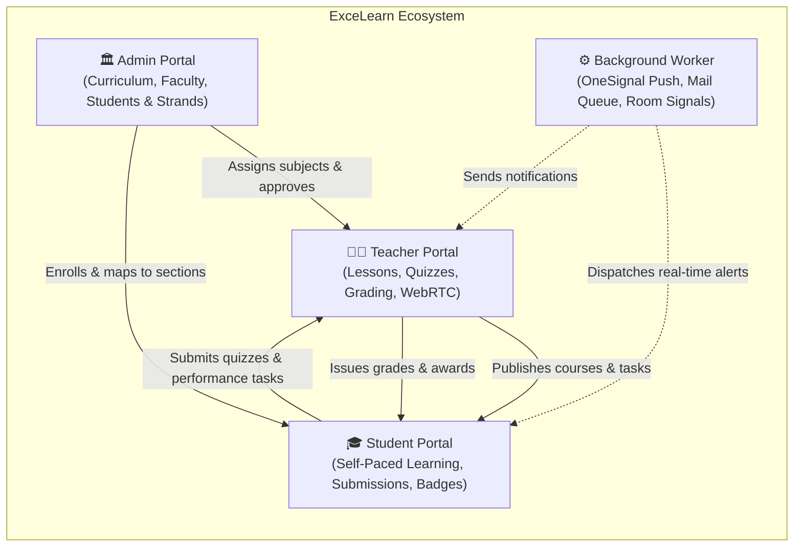

### Core Capabilities:
- **Role-Based Access Control (RBAC):** Three strictly separated boundaries (`Admin`, `Teacher`, `Student`) with individual session validation and cookie-based "Remember Me" authentication.
- **Academic Hierarchy Management:** Automated mapping of DepEd Tracks & Strands (STEM, TVL, HUMSS, etc.) to Grade Levels (11 & 12), Sections, and Subjects.
- **Course & Lesson Delivery:** Rich-media syllabus authoring with an integrated PDF modules reader (`pdf_viewer.php`) and lesson progress tracking.
- **Assessment Engine:** Timed multi-format quizzes (multiple choice, true/false, identification) with automated scoring, question-level analytics, and attempt limits.
- **Performance Tasks & Submissions:** Assignment management supporting digital artifact uploads, teacher rubric grading, and score weighting.
- **Real-Time Virtual Classroom:** Native peer-to-peer WebRTC video conferencing with screen sharing and in-database signal negotiation (`tblvirtualclass_signals`).
- **Institutional Reporting & Export:** Instant student masterlist imports via `PhpOffice/PhpSpreadsheet` and PDF certificate generation via `Dompdf`.
- **Automated Background Processing:** Detached background daemon (`background_worker/background_worker.php`) handling Web Push (`OneSignal`) and SMTP email notifications (`PHPMailer`).

---

## 2. High-Level Architecture & Entity Relationships

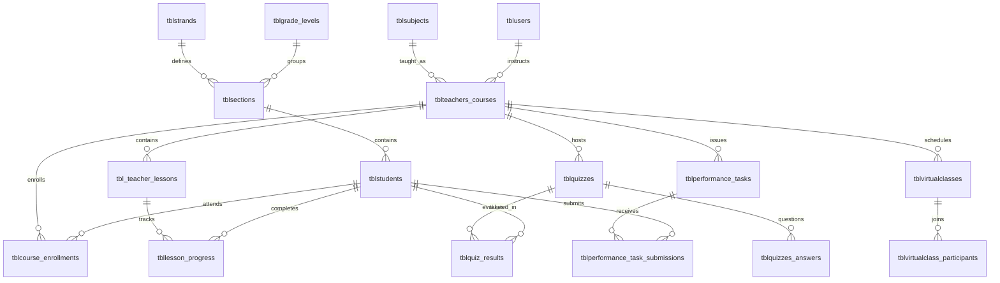

---

## 3. Folder Hierarchy & Structural Role Map

```
excelearn/
├── index.php                      # Universal Login Portal (Student LRN / Teacher-Admin Email)
├── default.php                    # Hostinger placeholder stub (non-functional landing)
├── register.php                   # Teacher self-registration (defaults to 'pending' state)
├── registration_pending.php       # "Awaiting Approval" confirmation page
├── forgotpassword.php             # Email verification & 6-digit OTP request
├── verifyforgotpassword.php       # OTP entry and validation handler
├── newpassword.php                # Password update submission
├── connection.php                 # MySQLi database connector & charset configuration
├── logout.php                     # Session destruction and cookie invalidation
├── composer.json                  # Dependencies: dompdf/dompdf, phpoffice/phpspreadsheet, phpmailer/phpmailer
├── u342202101_excelearn.sql       # Complete database dump (34 tables + seed data)
│
├── admin/                         # 🏛️ Administrator Subsystem
│   ├── index.php                  # Executive Dashboard: approvals, metrics & notices
│   ├── admin_teachers.php         # Teacher verification, approval, rejection & directory
│   ├── admin_students.php         # Student batch Excel import, LRN generation & records
│   ├── admin_subjects.php         # Subject curriculum catalog
│   ├── admin_sections.php         # Section assignments per Grade & Strand
│   ├── admin_strands.php          # Senior High School strand definitions
│   ├── admin_analytics.php        # Institutional enrollment & performance charts
│   ├── admin_reports.php          # Audit logs & downloadable institutional summaries
│   ├── admin_profile.php          # Admin credentials & security settings
│   ├── settings.php               # Theme configuration (Light / Dark)
│   └── about.php                  # Institution & system info
│
├── teachers/                      # 👩‍🏫 Faculty Subsystem
│   ├── index.php                  # Teacher Dashboard & announcement feed
│   ├── teacher_courses.php        # Course builder, lesson syllabus & PDF module uploads
│   ├── teacher_quizzes.php        # Quiz builder, scoring criteria & student answer review
│   ├── teacher_performance_tasks.php # Assignment builder, submission reviews & rubrics
│   ├── teacher_grades.php         # Gradebook calculation & quarterly grade compilation
│   ├── teacher_virtual_class.php  # WebRTC live room broadcast & screen share
│   ├── teacher_students.php       # Enrolled student rosters per section
│   ├── teacher_reports.php        # Subject-level student performance analytics
│   ├── teacher_profile.php        # Professional bio & teaching credentials
│   ├── update_education.php       # Educational background handler
│   ├── notif_mark_read.php        # Notification read AJAX handler
│   └── notif_delete.php           # Notification delete AJAX handler
│
├── students/                      # 🎓 Student Subsystem
│   ├── index.php                  # Student Home: summary cards, deadlines & announcements
│   ├── student_courses.php        # Course curriculum viewer
│   ├── student_lessons.php        # Interactive lesson reader & progress checklist
│   ├── pdf_viewer.php             # Embedded secure PDF viewer for lesson handouts
│   ├── student_quizzes.php        # Interactive quiz runner with countdown timer
│   ├── student_performance_tasks.php # Performance task submission & deliverable uploader
│   ├── student_grades.php         # Report card, quarterly grades & academic status
│   ├── student_certificates.php   # Achievement certificate generator (Dompdf)
│   ├── student_virtual_class.php  # WebRTC classroom viewer & audio/video participant
│   ├── join_virtual_class.php     # Class signaling bridge
│   ├── student_profile.php        # LRN, personal details & guardian info
│   └── settings.php               # Account security & UI theme toggle
│
├── background_worker/             # ⚙️ Asynchronous Task Daemon
│   ├── background_worker.php      # CLI/cron script: OneSignal push, emailer queue, cleanup
│   └── worker.log                 # Continuous execution audit log
│
├── screenshots/                   # UI documentation captures
├── assets/                        # Static assets (CSS, JS, school seals, icons)
└── uploads/                       # User uploads (profile pictures, PDFs, submissions)
```

---

## 4. User Journeys & Workflow Diagrams

### A. Authentication & Session Resolution Flow

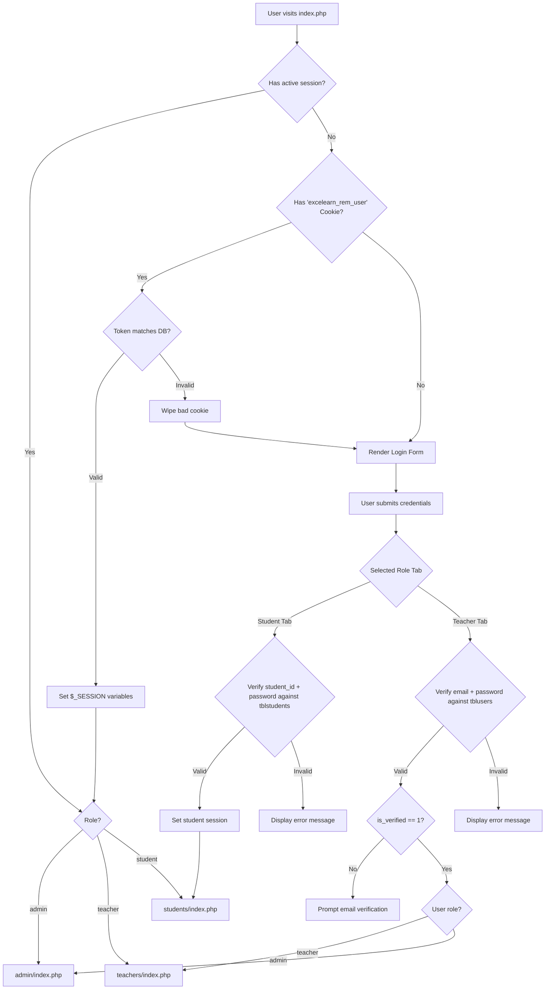

---

## 5. Step-by-Step UI Flow with Live Screenshots

### A. Public & Authentication Flow

#### Step 1: Universal Dual-Role Login (`index.php`)
The entry point features the Excelsior Polytechnic Academy crest, institutional mission statement, dark/light theme switch, and an interactive tabbed login separating **Student (by LRN/Student ID)** and **Teacher/Admin (by School Gmail)**.

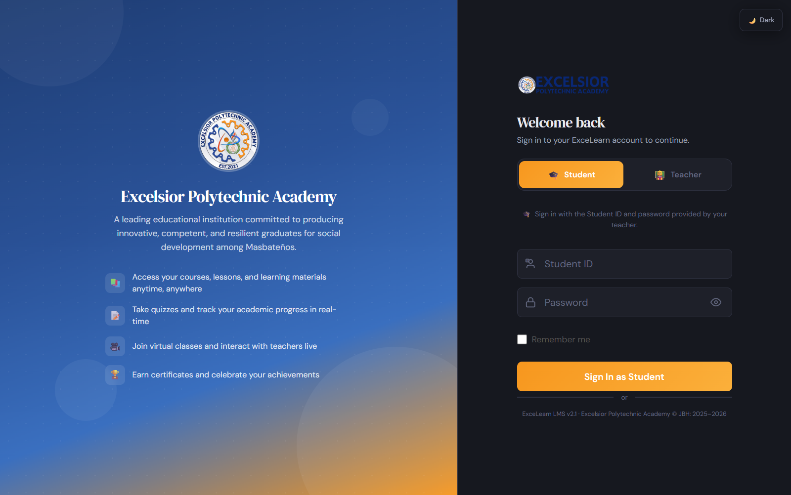

#### Step 2: Teacher Self-Registration (`register.php`)
New faculty members can create their account. Accounts are automatically placed in a `pending` state until reviewed and approved by the system administrator.

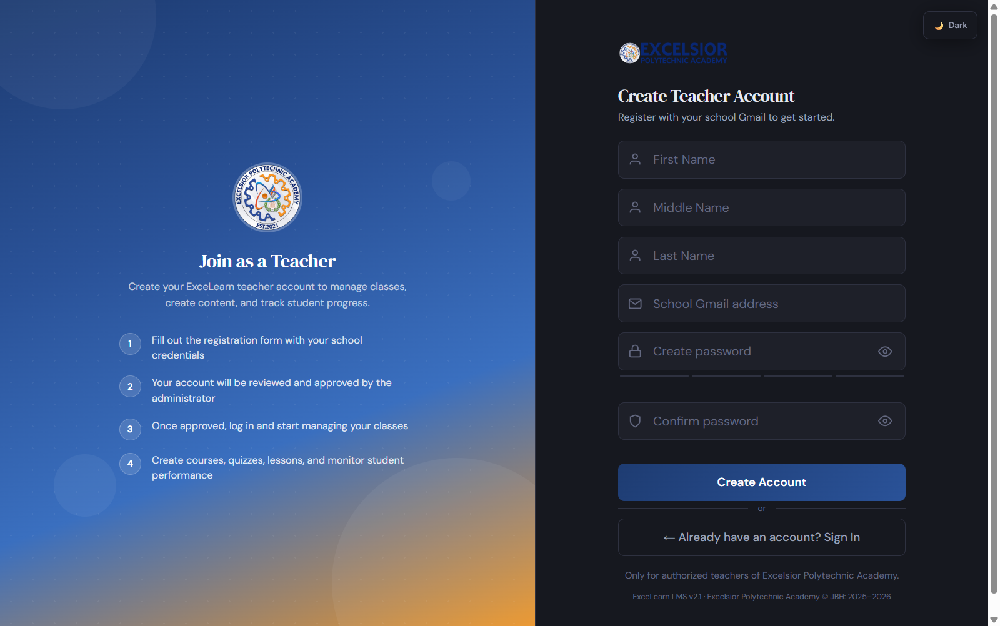

#### Step 3: Password Recovery (`forgotpassword.php`)
A 3-step security verification flow: email lookup, automated 6-digit OTP dispatch, and credential update.

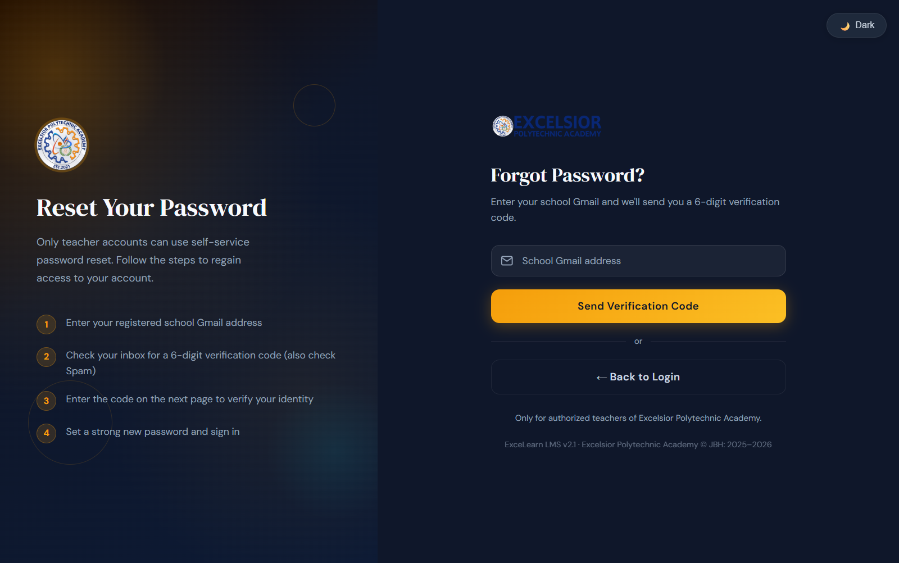

---

### B. Admin Portal Flow

#### Step 4: Executive Administration Dashboard (`admin/index.php`)
Provides high-level system indicators (Total Faculty, Total Students, Active Strands, Active Courses), pending teacher approval action buttons, and global announcement broadcasting.

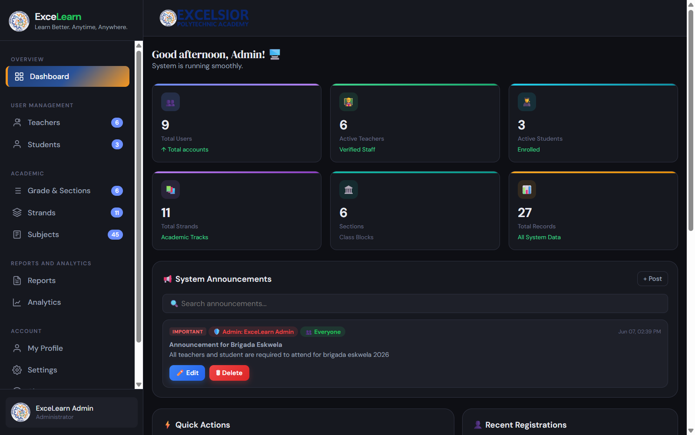

#### Step 5: Faculty Verification & Management (`admin/admin_teachers.php`)
Allows the administrator to approve, reject, or suspend teacher accounts, update contact records, and monitor teaching load assignments.

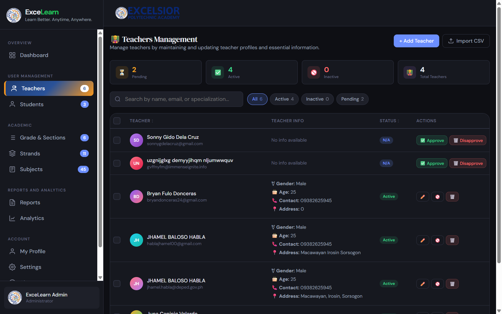

#### Step 6: Student Records & Batch Enrollment (`admin/admin_students.php`)
Enables manual student registration, bulk Excel spreadsheet ingestion via `PhpSpreadsheet`, section assignment, and LRN tracking.

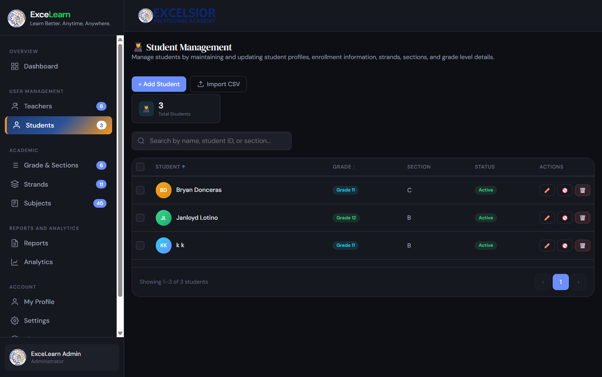

#### Step 7: Institutional Analytics & Reports (`admin/admin_analytics.php`)
Visual distribution of students across strands (STEM, TVL, HUMSS, etc.), section capacity metrics, and longitudinal platform engagement.

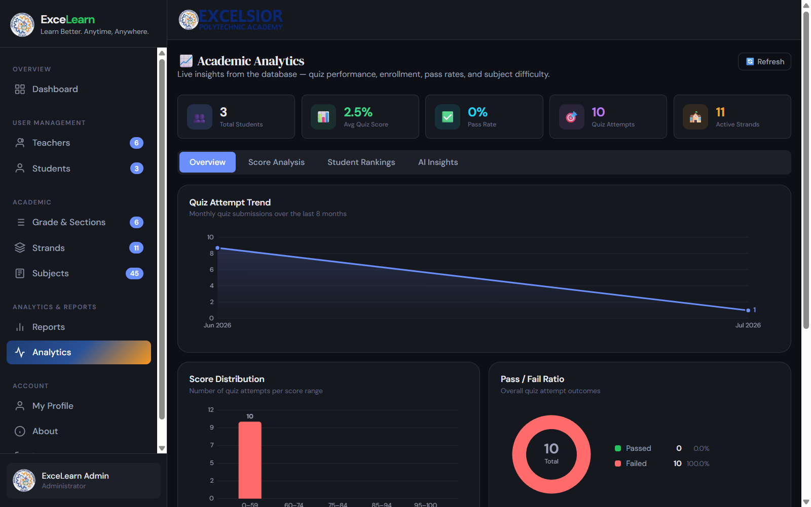

---

### C. Teacher Portal Flow

#### Step 8: Faculty Workspace (`teachers/index.php`)
Personalized teacher overview showing current courses, scheduled virtual classes, upcoming task deadlines, and student announcements.

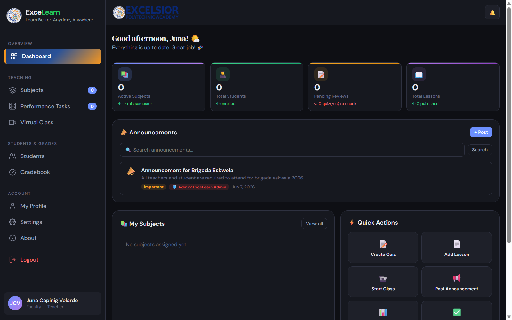

#### Step 9: Course & Curriculum Management (`teachers/teacher_courses.php`)
Instructors build lessons, upload downloadable PDF learning modules, organize units, and define learning competencies.

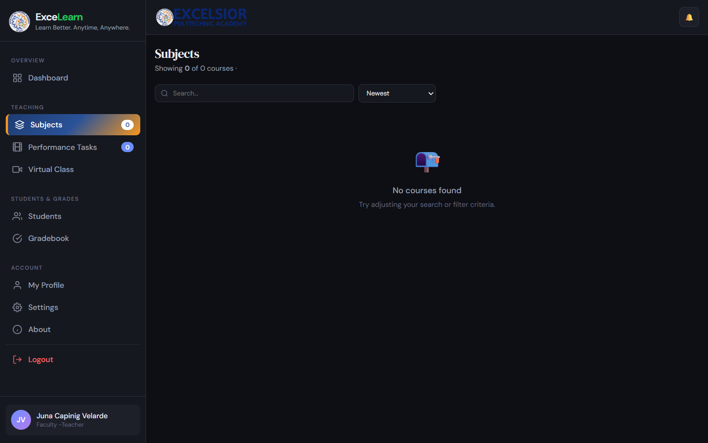

#### Step 10: Quiz Authoring & Scoring Suite (`teachers/teacher_quizzes.php`)
Authoring interface for timed quizzes with randomized question orders, multiple-choice question builders, and instant grade evaluation.

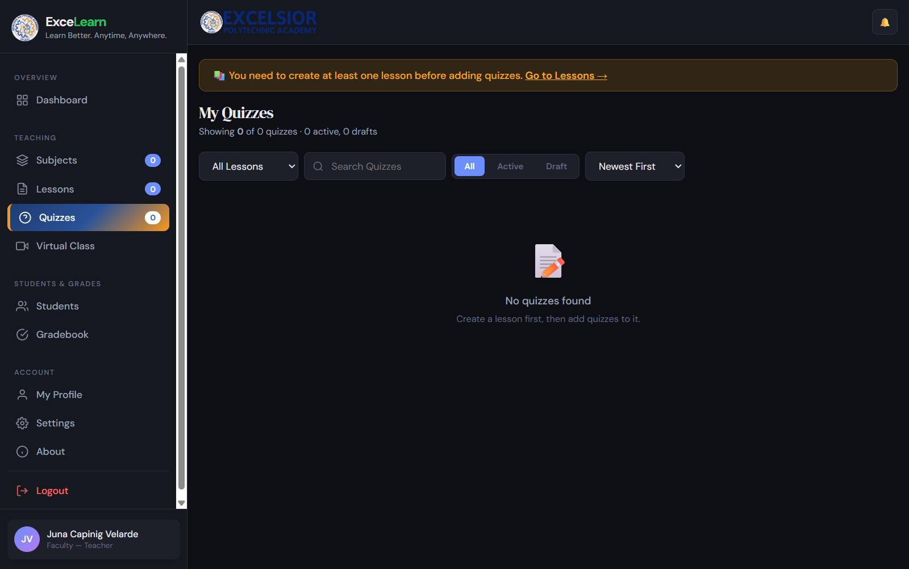

---

### D. Student Portal Flow

#### Step 11: Learner Dashboard (`students/index.php`)
A clean dashboard designed for high school learners featuring enrolled subject cards, upcoming quiz deadlines, pending performance tasks, and school notices.

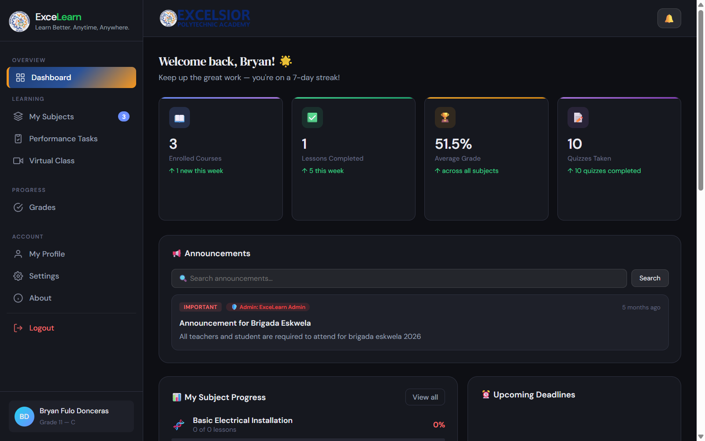

#### Step 12: Subject Modules & Lessons (`students/student_courses.php`)
Students can browse enrolled subjects, view lesson syllabi, and launch the built-in PDF reader (`pdf_viewer.php`) without leaving the portal.

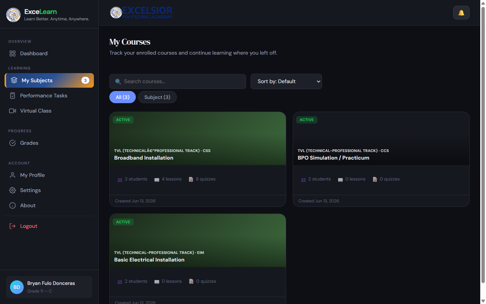

#### Step 13: Interactive Quiz Environment (`students/student_quizzes.php`)
Learners access pending quizzes with real-time countdown clocks, question pagination, automatic submit on timer expiry, and instant grade displays.

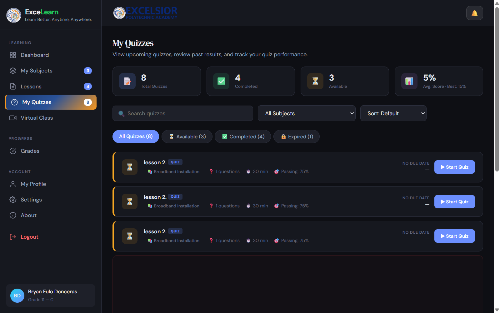

#### Step 14: WebRTC Live Classroom (`students/student_virtual_class.php`)
Students join live virtual lectures initiated by teachers. Includes microphone/camera toggles, real-time participant roster, and screen share feed.

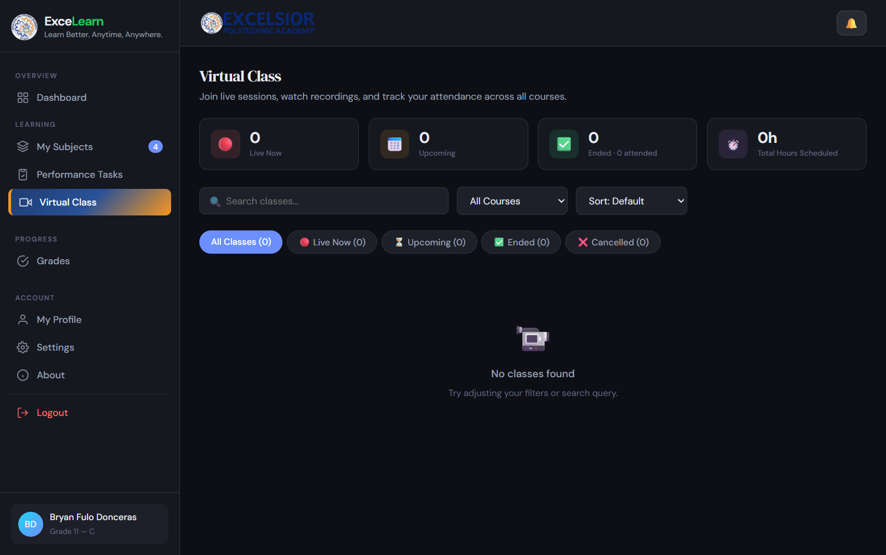

---

## 6. How to Run Locally (Step-by-Step Manual)

### Prerequisites
1. **PHP:** Version `8.1` or `8.2+` (with `mysqli`, `curl`, `mbstring`, `fileinfo`, and `gd` extensions enabled).
2. **Database:** MariaDB `10.4+` or MySQL `8.0+` (e.g. via XAMPP, Laragon, or standalone).
3. **Web Server:** PHP built-in server or Apache.

---

### Step 1: Start MySQL Database
If using XAMPP:
1. Open **XAMPP Control Panel**.
2. Click **Start** on **MySQL**.

Or start via terminal:
```powershell
& "C:\xampp\mysql\bin\mysqld.exe"
```

---

### Step 2: Create the Database & User
In XAMPP MySQL (or phpMyAdmin at `http://localhost/phpmyadmin`):
```sql
CREATE DATABASE IF NOT EXISTS u342202101_excelearn;

-- Create the user matching connection.php
CREATE USER IF NOT EXISTS 'u342202101_excelearn'@'localhost' IDENTIFIED BY '6S+?/2^n|k?BMhhs';
GRANT ALL PRIVILEGES ON u342202101_excelearn.* TO 'u342202101_excelearn'@'localhost';
FLUSH PRIVILEGES;
```

---

### Step 3: Import Database Dump (`u342202101_excelearn.sql`)

> [!WARNING]
> **Collation Incompatibility Fix (Critical for XAMPP):**  
> The exported `.sql` dump contains `utf8mb4_uca1400_ai_ci` (MariaDB 10.11+ Unicode 14 collation). If importing into standard XAMPP (MariaDB 10.4), MySQL will fail with `ERROR 1273 (HY000): Unknown collation`.  
> Run this one-line command to make it compatible prior to importing:
> ```powershell
> (Get-Content -Path .\u342202101_excelearn.sql -Raw) -replace 'utf8mb4_uca1400_ai_ci', 'utf8mb4_unicode_ci' | Set-Content -Path .\import_ready.sql -Encoding UTF8
> ```

Now import `import_ready.sql`:
```powershell
cmd /c "C:\xampp\mysql\bin\mysql.exe -u root u342202101_excelearn < import_ready.sql"
Remove-Item -Path .\import_ready.sql -Force
```

---

### Step 4: Launch the Local PHP Server
From the root directory (`d:\excelearn`):
```powershell
& "C:\xampp\php\php.exe" -S localhost:8000 -t d:\excelearn
```

Now open your web browser:
👉 **`http://localhost:8000/index.php`**

---

## 7. Default User Credentials & Tier Reference

All test accounts in the local database have been synchronized to use the password: **`Admin@123`**.

### 🏛️ Administrator Tier
*Select the **👩‍🏫 Teacher** tab on `index.php`.*

| Role | Username / Email | Password |
| :--- | :--- | :--- |
| **Super Admin** | `excelsiorpolyacad@gmail.com` | `Admin@123` |

### 👩‍🏫 Teacher / Faculty Tier
*Select the **👩‍🏫 Teacher** tab on `index.php`.*

| Teacher Name | Username / Email | Password |
| :--- | :--- | :--- |
| **Juna Velarde** | `junacvelarde@gmail.com` | `Admin@123` |
| **Jhamel Habla** | `jhamel.habla@deped.gov.ph` | `Admin@123` |
| **Bryan Donceras** | `bryandonceras24@gmail.com` | `Admin@123` |
| **Sonny Dela Cruz** | `sonnygdelacruz@gmail.com` | `Admin@123` |

### 🎓 Student Tier
*Select the **🎓 Student** tab on `index.php`.*

| Student Name | Student ID (Username) | DepEd LRN | Password |
| :--- | :--- | :--- | :--- |
| **Bryan Donceras** | `STUD-123456` | `46443754754342` | `Admin@123` |
| **Janloyd Lotino** | `STUD-2026-12345` | `12345678910` | `Admin@123` |
| **Test Student** | `stud123` | `k` | `Admin@123` |

---

## 8. Database Collation Trap & Troubleshooting

| Symptom | Root Cause | Resolution |
| :--- | :--- | :--- |
| `ERROR 1273: Unknown collation: 'utf8mb4_uca1400_ai_ci'` | MariaDB 10.11+ export imported into MariaDB 10.4 | Replace `utf8mb4_uca1400_ai_ci` with `utf8mb4_unicode_ci` prior to import. |
| Blank page or `Fatal error: Class "mysqli" not found` | PHP `mysqli` extension disabled | Uncomment `extension=mysqli` in `php.ini`. |
| "Incorrect password" | Password hashes in SQL dump used original unknown strings | Reset password using `password_hash()` in a quick PHP script. |
| PDF certificate download errors | Missing `ext-gd` or `ext-mbstring` | Enable `extension=gd` and `extension=mbstring` in `php.ini`. |
| Push notifications not sending | Background worker is not running | Run `php background_worker/background_worker.php` manually or as a scheduled task. |

---
*Excelsior Polytechnic Academy © 2025–2026*
